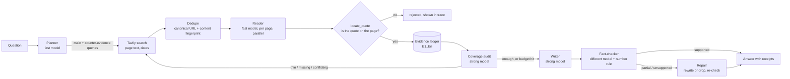

# Receipts: research answers that show their receipts

> ODSC × Nebius Hackathon submission · Challenge: *Build a research agent that brings its sources*

**One-line pitch:** Ask a research question and get a short answer where every sentence links to the exact sentence on a live web page that supports it. A program checks that each quote is really on the page, a second model checks each sentence against its quotes, and anything that fails is fixed or removed in front of you.

- **Demo video (2–3 min):** [[VIDEO_URL]]
- **Live demo:** [[LIVE_URL]] (recorded runs replay instantly; live questions are rate-limited)
- **Team:** Mridhula Srinivasan ([@mritopper](https://github.com/mritopper))


## The problem

Analysts, reporters, policy staff and students all hit the same wall with AI research tools. The answer reads well, the citations look right, and then one of them turns out not to say what the sentence claims. Checking means opening every link and hunting for the passage, which is the work the tool was supposed to save. So people either skip the check and repeat errors, or stop trusting the tool.

**Receipts is for anyone who has to put their name on an answer.** Its job is to make an answer as cheap to *verify* as it is to read:

- Every factual sentence carries one or more **receipts**: a verbatim quote, the page title, site, source tier and publication date.
- **"Open page at this quote"** opens the source scrolled to the quoted passage, highlighted (via [Text Fragments](https://developer.mozilla.org/en-US/docs/Web/URI/Reference/Fragment/Text_fragments) in Chromium browsers). Checking a claim takes one click.
- Facts and **inferences** are labelled differently. **Disagreements** between sources are shown side by side with a likely reason. **Gaps** are listed. Sentences that failed the fact-check are shown **struck through with the reason**, not silently hidden.
- When the web doesn't support an answer, it says **"Insufficient evidence"** and shows what it searched, rather than answering from memory.
- **Copy as Markdown** exports the answer with footnotes that carry the quotes, so it can be pasted into a memo or article.

## How it works

```
question → plan sub-questions (+ counter-evidence queries) → Tavily search → dedupe
        → read pages, extract verbatim quotes → PROGRAM verifies each quote is on the page
        → coverage audit → follow-up searches or stop
        → write sentence-level answer citing evidence ids
        → INDEPENDENT model fact-checks each sentence against only its quotes (+ rule: every figure must appear in a quote)
        → repair or remove failing sentences → answer with receipts
```



### Query planning, and when it stops

- The **planner** splits the question into 1–4 sub-questions. Each gets a **main query** and a **counter-evidence query** that looks for disagreement, corrections or newer figures. Searching only for confirmation is how research tools end up one-sided.
- If the question depends on recent information, the planner sets a Tavily `time_range`. If a filtered search comes back empty, the agent **broadens once** (drops the filter) and says so in the trace.
- After each round, a **coverage audit** marks every sub-question as `answered` (2+ independent sites, or 1 primary source), `thin`, `conflicting` or `missing`. A deterministic count is computed alongside the model's view. The model proposes at most 3 follow-up queries, and queries that were already run are refused.
- **Stops when:** every sub-question has independent support, the audit finds no better query, a follow-up round turns up no new pages, or the round budget (`RC_MAX_ROUNDS`, default 2) runs out. The stop reason is shown.

### Evidence selection, dedupe and checks before writing

- Tavily results come back with full page text (`include_raw_content`). Pages are deduplicated by **canonical URL** (tracking parameters, `www.`/`m.`, trailing slashes) and by **content fingerprint**, which catches syndicated copies of one story on different sites.
- Each page gets a **source tier** (`primary`: .gov, .edu, regulators, journals; `reputable`: major news and reference; `unvetted`). It's a heuristic hint shown to the writer, the checker and the reader, not a verdict.
- The **reader** model copies up to 4 verbatim quotes per page. `verify.locate_quote` then looks for each one in the page text: exact match after normalising typography, then quotes with `...` gaps (each part must appear in order), then a strict fuzzy match (≥ 90%) that is **rejected if it changed any number or flipped a negation**. Quotes that aren't found are discarded, and the shown quote is replaced with **the page's own wording**.
- Writing is **sentence by sentence**. Each sentence is `fact` or `inference` and cites evidence ids, and unknown ids are stripped.
- The **checker** is a *different* model family from the writer when the catalogue allows it, so the writer isn't grading its own work. It sees only the sentence and its cited quotes. A rule caps a sentence at `partial` if it contains a figure that appears in none of its quotes.
- The **repair** step narrows or drops failing sentences and re-checks rewrites. Anything still unsupported is removed and listed under *Caught by the fact-check*. If no fact sentence survives, the status becomes **Insufficient evidence**.

### Keeping web content away from instructions

- Page text only reaches a model inside `<untrusted_source>` / `<evidence>` tags. Every system prompt states that tagged text is data and never instructions, and tag look-alikes inside pages are neutralised so a page can't close its own sandbox.
- Pages are scanned for prompt-injection phrasing ("ignore previous instructions", role overrides, tag spoofing). Flagged sources are marked in the trace and source list, and any quote containing such phrasing is dropped.
- Nothing a model writes is trusted as a citation until the program finds it on the page.

### Trade-offs: latency, cost, reliability

| Choice | Why |
|---|---|
| Three roles on three model tiers (`fast` reads many pages, `strong` writes, `check` verifies) | Most tokens are page text going to the reader, so a small MoE model keeps a run cheap (see cost below). The expensive model writes once. |
| Reader calls run in parallel (bounded by `RC_MAX_PARALLEL`) | Reading 10–18 pages one by one would dominate latency. |
| Counter-evidence queries use `basic` Tavily depth; main and follow-up queries use `advanced` | Spend search credits where relevance matters most. |
| At most 2 search rounds and 18 sources | A predictable 40–90 s research run, not an open-ended loop. |
| Deterministic checks (quote location, figures, dedupe) before any model judgement | Cheap, fast, and impossible to argue with. |
| Every Token Factory and Tavily call retries with backoff; Token Factory falls back across endpoints; JSON replies get one stricter retry | A flaky call shows up as a warning in the trace, not as a made-up answer. |
| Disk cache for model and search calls during development (`RC_CACHE=0` disables it) | Fast iteration. Recordings and benchmarks always run uncached. |

## Required services

| Requirement | How Receipts uses it |
|---|---|
| **Nebius Token Factory** (inference) | All inference: planner, page reader, coverage audit, writer, fact-checker and repair, via the OpenAI-compatible `/v1/chat/completions`. Models are **discovered from `/v1/models` at start-up** (with live per-token pricing for the cost meter), one per role. Models used for the recorded runs: [[MODELS]]. Hybrid-reasoning models get thinking switched off (`chat_template_kwargs`) because every role returns short structured JSON. Override any role with `RC_MODEL_FAST` / `RC_MODEL_STRONG` / `RC_MODEL_CHECK`. |
| **Tavily** (real-time web search) | Every piece of evidence comes from Tavily: `search_depth` advanced/basic per query type, `include_raw_content` so quotes can be verified against full page text, `time_range` for time-sensitive questions, `published_date` for dates. `include_answer` is **off**: the answer is written only from page text, never from a search summary. Tavily result URLs survive into every receipt and every exported footnote. |

API keys are read from `.env` (git-ignored) and never logged. The UI and trace show model names, token counts and cost, never credentials.

## Setup

```bash
git clone https://github.com/mritopper/receipts
cd receipts
python -m venv .venv && source .venv/bin/activate
pip install -r requirements.txt
cp .env.example .env          # paste NEBIUS_API_KEY and TAVILY_API_KEY; never commit them
python src/agent.py "What share of US electricity do data centers use today?"
```

The CLI prints the live research trace to stderr and the answer, with footnoted quotes, to stdout (`--json` for the full report).

**Web UI** (live trace, clickable receipts, replays of recorded runs):

```bash
uvicorn receipts.server:app --port 8000     # then open http://localhost:8000
```

**Check your keys** (lists the models picked per role and makes one call to each service):

```bash
python scripts/smoke.py
```

**Tests** run offline against in-process fakes of both APIs, no keys needed:

```bash
pip install -r requirements-dev.txt && pytest -q
```

`RC_MOCK=1` runs the whole UI on canned offline data for development. Mock output is labelled "MOCK DATA, NOT A REAL RESULT" everywhere, and the benchmark and recording scripts refuse to run in mock mode.

## Example

[[EXAMPLE]]

## Failure and insufficient-evidence cases

- **The web has no answer.** *"Who won the 2031 FIFA Women's World Cup final?"* [[INSUFFICIENT_EXAMPLE]]
- **A search returns nothing.** The trace shows `no results`. With a date filter, the agent retries once without it ("filter removed, retried").
- **A tool fails.** Tavily or Token Factory errors are retried with backoff. A search round where every call failed produces a visible warning, and failures are listed in the report (`stats.failures`). With no verified evidence, the agent stops and says "Insufficient evidence" without asking a model to write anything.
- **The model makes up a quote.** The program can't find it on the page, so it's rejected and shown struck through in the trace under "quotes not found on the page".
- **The checker returns no verdict.** The sentence is `unchecked`, never presented as supported, and if nothing is verified the status is "Insufficient evidence" (tested in `tests/test_agent.py`).

## Benchmark: Receipts vs the template's one-shot agent

`eval/run_eval.py` runs [12 questions](eval/questions.jsonl) (current events, contested science, factual, and 2 that the web can't answer) through the **hackathon template's agent** (one Tavily search, one Token Factory call) and through **Receipts**, both on the same writer model. The **same independent checker model** then labels every answer sentence against the text it cites. Every number below is written by the script to [`eval/RESULTS.md`](eval/RESULTS.md); none are hand-entered.

[[RESULTS]]

## Judging criteria map

| Criterion | Weight | Where to look |
|---|---|---|
| Sourced and verifiable answers | 30% | Receipts card with verbatim quote and "open page at this quote" · fact vs inference labels · conflicts and gaps sections · benchmark supported-rate · demo 0:20–1:10 |
| Works end to end | 25% | Setup above · live trace with real Token Factory + Tavily calls · failure cases above · offline test suite (CI) · demo 1:10–1:50 |
| Usefulness | 20% | The problem · Markdown export with quote footnotes · one-click verification · demo 0:00–0:20 |
| Agent design | 15% | How it works · stop rules · evidence checks · injection handling · trade-offs · trace panel |
| Use of Token Factory and Tavily | 10% | Required services · per-role model discovery and cost meter · Tavily raw content + time range + dates |

## Repository layout

```
receipts/agent.py     the research loop (plan → search → read → coverage → write → check → repair)
receipts/verify.py    deterministic checks: quote location, figure grounding, text-fragment links
receipts/safety.py    untrusted-content wrapping and prompt-injection scan
receipts/search.py    Tavily client, dedupe, source tiers
receipts/llm.py       Token Factory client: model discovery, retries, endpoint fallback, cost ledger
receipts/prompts.py   every prompt, in one file
receipts/server.py    FastAPI + Server-Sent Events; receipts/static/ is the zero-build UI
src/agent.py          template entry point (CLI)
eval/                 benchmark questions, script and results
tests/                offline tests (fakes of both APIs)
```

## License

MIT
